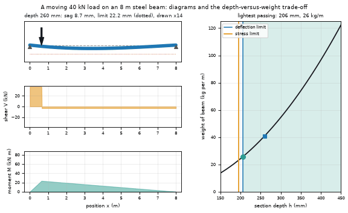
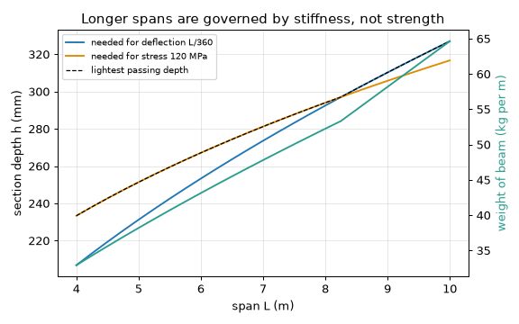
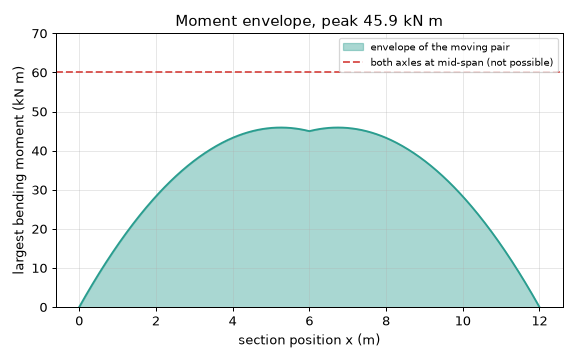
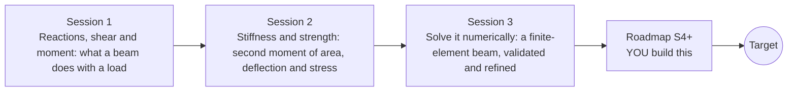

# openbeam

[](https://github.com/KrunalPanchal1995/openbeam/actions/workflows/ci.yml)   [](https://colab.research.google.com/github/KrunalPanchal1995/openbeam/blob/main/sessions/session-01/lesson.ipynb) [](https://krunalpanchal1995.github.io/openbeam/)

**Find the lightest beam that does not sag too much, in three sessions.**

openbeam teaches how a loaded beam carries its load, from reactions and bending-moment diagrams to a finite-element solver you can check against hand formulas, using only Python and a browser.

- **Start from a plank.** Session 1 needs only school algebra: forces balance, and a beam bends most where the moment is largest.
- **See it bend.** Every session ships a slider app that runs in the browser, with labelled shear, moment and deflection graphs.
- **Know you got it right.** Each session ends with a checkpoint that prints PASS or FAIL against hand calculations and exact formulas.
- **Build the missing half.** The repo stops at Session 3 on purpose; the roadmap shows the path to the Target.

[Target](#the-target) · [Who is this for](#who-is-this-for) · [Quick start](#quick-start) · [Sessions](#sessions) · [Roadmap](#roadmap) · [Contribute](#contribute) · [Explainer PDF](docs/explainer.pdf)

> **This repo is incomplete on purpose.** Sessions 1 to 3 are here and fully working. The finished Target below is a preview of what the community can build next. We show you the path, not the code. Sessions 4 and up are yours.

## The Target

A load rolls across a steel-like beam. The beam sags under it (drawn enlarged), while the shear, moment and deflection diagrams below it move with the load. On the right, a depth-versus-weight chart shows the trade-off: a deeper beam is stiffer, but heavier, and the lightest beam that meets the deflection limit and the stress limit sits right where the two limit curves cross. Your goal over the coming sessions: build this explorer yourself, then add an I-section and a moving-load envelope.



*Target: a load crossing a beam, with moving shear, moment and deflection diagrams and the depth-versus-weight trade-off*



*Target chart: lightest beam depth that meets the deflection and stress limits*



*Target chart: moment envelope of a moving two-axle load against one fixed load*

Try it live:

- [Math Visual Studio: 1D finite elements (Atlas S86)](https://krunalpanchal1995.github.io/studio/#atlas?ch=S86&ex=1)
- [Math Visual Studio: open playground](https://krunalpanchal1995.github.io/studio/)

How the Target was made is shown only as a path in [promo/roadmap.md](promo/roadmap.md).

## Who is this for
**diploma / undergraduate to advanced undergraduate (levels 5-6).** Topic area: Civil Engineering and Construction.

Prerequisites:

- School algebra and the idea of a force and a moment (force times distance).
- Python 3.10 or newer; if `python --version` works, you are ready. PRIMER.md explains the rest.
- No prior GitHub, structures or finite-element experience is needed.

New to Python? Read [PRIMER.md](PRIMER.md) first (10 minutes).

## Quick start

No installation knowledge needed. You need [Git](https://git-scm.com/downloads) and [Python 3.10+](https://www.python.org/downloads/) (Windows: tick "Add Python to PATH"). On Mac and Linux type `python3` wherever this page says `python`.

```bash
git clone https://github.com/KrunalPanchal1995/openbeam.git
cd openbeam
python start.py 1
```

`start.py` creates a private environment, installs what is needed and runs Session 1 with its checkpoint. Next: `python start.py 2`, `python start.py 3`, or `python start.py test` to check everything. Only a checkpoint: `python start.py check 1`.

Three lines turn the idea of Session 2 into a result (they work as they are): Save it as `try.py` and run it with `python start.py run try.py` (this uses the private environment, where NumPy is installed):

```python
import numpy as np
P, L, E = 10e3, 4.0, 10e9                      # 10 kN centre load, 4 m span, timber-like E
I = 0.100 * 0.200 ** 3 / 12                     # 100 mm wide, 200 mm deep rectangle: I = b h^3 / 12 (m^4)
print(round(P * L ** 3 / (48 * E * I) * 1e3, 1), 'mm sag')   # -> 20.0 mm sag, against a limit L/360 = 11.1 mm
```

Every session also opens in your browser with sliders (no install): [live apps](https://krunalpanchal1995.github.io/openbeam/). Or use the Colab badge above for the notebook.

## Sessions

| # | Session | Model level | Time | Live app |
|---|---|---|---|---|
| 1 | [Reactions, shear and moment: what a beam does with a load](sessions/session-01/README.md) | Level 1: conceptual interactive model | 60 min | [open](https://krunalpanchal1995.github.io/openbeam/session-01/) |
| 2 | [Stiffness and strength: second moment of area, deflection and stress](sessions/session-02/README.md) | Level 2: mathematical engineering model | 80 min | [open](https://krunalpanchal1995.github.io/openbeam/session-02/) |
| 3 | [Solve it numerically: a finite-element beam, validated and refined](sessions/session-03/README.md) | Level 3: simulation and validation | 90 min | [open](https://krunalpanchal1995.github.io/openbeam/session-03/) |

Each session follows the same six steps: A real-world problem, B concept and theory, C visual explanation, D interactive simulation, E worked example and experiment, F assessment and design challenge. Each ends with `checkpoint.py`, which prints `PASS` or `FAIL` against reference numbers. Session 3 also contains the real-world mini-project: **Check a footbridge girder (classroom exercise only)**.

## Architecture



| Folder or file | What is inside |
|---|---|
| `sessions/` | three sessions: README (A-F), `lesson.py`, notebook, live app, exercises, activity sheet, checkpoint |
| `promo/` | the Target: media, live links, and the roadmap (path only) |
| `docs/` | `explainer.tex` and the built `explainer.pdf` |
| `tests/` | runs every lesson and checkpoint headless |
| `start.py` | one command to set up and run anything |
| `QUALITY.md`, `RUBRIC.md` | the quality checklist and the scoring rubric |
| `.github/` | CI, PDF build, Pages deploy, issue and PR templates |

## Roadmap

| Milestone | What you will build | Difficulty |
|---|---|---|
| Session 4: Lightest I-section by search | A search over I-section dimensions for the footbridge girder, with the proportion limits you choose and state. | intermediate |
| Session 5: Moving-load envelope | A function that sweeps a two-axle load (2 x 10 kN, 3 m apart) along a 12 m span and records the largest moment at each section. | intermediate |
| Session 6: Continuous beam with a middle support | An extension of `solve_beam` with an interior support, for two equal spans under a uniform load. | advanced |
| Session 7: Shear deformation (Timoshenko element) | A beam element that includes shear deformation. | advanced |
| Session 8: Depth-versus-weight explorer | An animation or app that shows the beam, the shear, moment and deflection diagrams and the lightest passing depth for any span. | advanced |

Full detail with a checkpoint per milestone: [promo/roadmap.md](promo/roadmap.md).

## Contribute
New to GitHub? Read [CONTRIBUTING.md](CONTRIBUTING.md); it starts from zero. Pick an issue labelled `good first issue`. Translations into Hindi, Telugu, Tamil and Malayalam are welcome.

<details>
<summary>Development</summary>

```bash
python start.py test        # runs every lesson and checkpoint
```
Lessons use `# %%` cell markers so they open as notebooks in VS Code. See [QUALITY.md](QUALITY.md) for the standard every session meets.
</details>

## License
MIT. See [LICENSE](LICENSE). Media in `promo/media` is (c) Krunal Panchal, CC BY 4.0.

## Acknowledgments
Part of the [PAN IIT OSS](https://hellofoss.tech-iitb.org/projects) open-source teaching collection, modelled on the structure of [openspline](https://github.com/openspline/openspline). Built on ideas from the Math Visual Studio at https://krunalpanchal1995.github.io/studio/.
