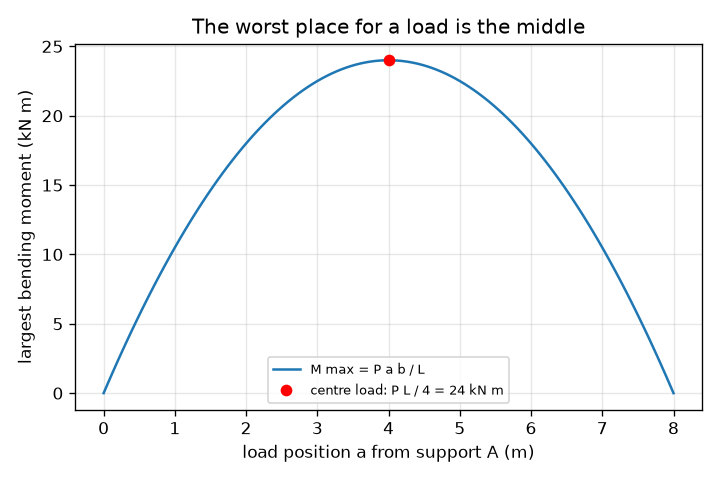
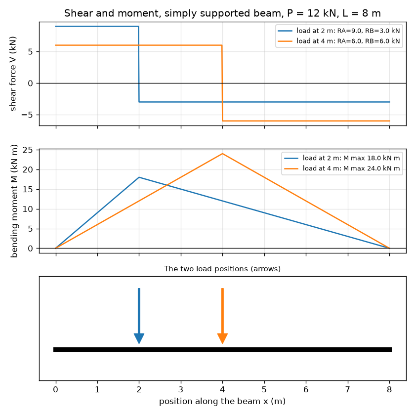

# Session 1: Reactions, shear and moment: what a beam does with a load

*Level 1 (conceptual interactive model) · about 60 minutes · openbeam*

> This is a simplified educational model. It is not a validated design tool and must not be used for real structures, electrical installations, vehicles, industrial processes or medical decisions.

**Prerequisites**

- School algebra.
- The idea of a moment: force times distance from a pivot.
- You have read PRIMER.md and run `python start.py 1` once.

**Learning objectives.** After this session you can:

- Find the support reactions of a simply supported beam with a point load from force and moment balance.
- Draw the shear force and bending moment diagrams and say how they are related.
- Locate the largest bending moment and explain why a centred load is the worst position.
- Read a shear or moment diagram on a graph with units.

## A. Real-world problem
A plank across a stream bends when you stand on it. Two things hold it up: the two banks. How much of your weight does each bank carry? Where inside the plank is the bending worst? Engineers answer with three pictures: the reactions at the supports, the shear force diagram and the bending moment diagram. This repo is a classroom model: it teaches the ideas, and is never a tool for designing a real structure.

## B. Concept and theory
A simply supported beam of span L rests on a support at x = 0 (A) and x = L (B). A downward point load P acts at distance a from A, and b = L - a from B. The beam stays still, so forces balance (RA + RB = P) and turning effects about A balance (RB L = P a). Cutting the beam at x and keeping the left piece shows what the inside of the beam must supply: a vertical shear force V and a bending moment M. M is largest where V changes sign. The slope of the moment diagram equals the shear force.

| Symbol | Meaning | Unit |
|---|---|---|
| P | point load (downward) | kN |
| L | span between supports | m |
| a, b | distances of the load from support A and B (b = L - a) | m |
| RA, RB | support reactions (upward) | kN |
| V(x) | shear force at position x | kN |
| M(x) | bending moment at position x (sagging positive) | kN m |

**Assumptions**

- The beam is straight, rigid enough that its bending does not change the forces, and its own weight is ignored.
- Supports are simple: they hold the beam up but allow it to turn.
- The load is a point load acting straight down.

$$ R_A=\frac{P\,b}{L},\qquad R_B=\frac{P\,a}{L},\qquad R_A+R_B=P $$

$$ V(x)=R_A\ (x<a),\qquad V(x)=R_A-P\ (x>a) $$

$$ M(x)=R_A\,x\ (x\le a),\qquad M(x)=R_A\,x-P\,(x-a)\ (x\ge a),\qquad M_{\max}=\frac{P\,a\,b}{L} $$

## C. Visual explanation
The first figure shows shear force and bending moment diagrams for the same 12 kN load placed at two positions on an 8 m beam. The shear diagram is two flat steps that change sign at the load; the moment diagram is a tent whose peak sits under the load. Moving the load towards the middle makes the tent taller. The second figure plots the largest moment against the load position: a parabola with its top at the centre, where it equals P L / 4 = 24 kN m.

*The largest moment against load position: highest at the centre, P L / 4 = 24 kN m.*

*Shear and moment diagrams for the same 12 kN load at 2 m and at 4 m on an 8 m beam.*

## D. Interactive simulation
Run the lesson (`python start.py 1`), then open the live app: [Session 1: reactions, shear and moment](https://krunalpanchal1995.github.io/openbeam/session-01/) (or `app.html` in this folder). Drag the load position and watch the two reactions trade places, then switch to the shear and moment views and see the tent peak move with the load.

**Challenge.** Carry a load of at least 10 kN while the right support carries no more than 2.5 kN.

## E. Worked example and experiment
**Problem.** A beam spans L = 8 m. A load P = 12 kN acts at a = 2 m from the left support. Find the reactions, the shear force on each side of the load and the largest bending moment.

1. b = L - a = 8 - 2 = 6 m.
2. Turning about A: RB x 8 = 12 x 2, so RB = 24 / 8 = 3 kN.
3. Forces: RA = 12 - 3 = 9 kN. Check with RA = P b / L = 12 x 6 / 8 = 9 kN.
4. Shear: V = +9 kN from x = 0 to 2 m, then 9 - 12 = -3 kN from 2 m to 8 m.
5. Largest moment is under the load: M = RA x a = 9 x 2 = 18 kN m. Check from the right: RB x b = 3 x 6 = 18 kN m. The two agree and equal P a b / L = 12 x 2 x 6 / 8 = 18 kN m.

**Answer.** RA = 9 kN, RB = 3 kN; shear +9 kN then -3 kN; largest moment 18 kN m at x = 2 m.

**Experiment.** Rest a metre ruler on two kitchen scales, one under each end, and hang a known weight from a loop at a chosen point. Read both scales: they should add up to the weight and match P b / L and P a / L to within the scale accuracy. Differences come from the ruler's own weight, which the model ignores, and from the scale readings: the model has a perfectly point-like load and perfect supports.

## F. Assessment and design challenge
**Question type A: Conceptual.** Why does the support closer to the load carry more of it? What happens to the two reactions when the load slides to exactly the middle?

Hint

Think of a see-saw: which end must push harder to stop it turning?

Step-by-step solution

Balance of turning effects about the far support shows that the near support must supply the bigger share (RA = P b / L is bigger when b, the distance to the far support, is bigger). At the middle a = b = L / 2, so both reactions equal P / 2.

**Question type B: Numerical.** A 20 kN load acts 1.5 m from the left support of a 5 m beam. Find RA, RB and the largest bending moment, with units, and check that the answers are sensible.

Hint

b = 3.5 m. Use RA = P b / L and M = RA a.

Step-by-step solution

RA = 20 x 3.5 / 5 = 14 kN, RB = 20 x 1.5 / 5 = 6 kN. Check: 14 + 6 = 20 kN. M max = 14 x 1.5 = 21 kN m (also 6 x 3.5 = 21 kN m). The bigger reaction is on the side nearer the load, as expected.

**Question type C: Graph and simulation interpretation.** On the moment graph, where is the peak, what is the slope of the line to its left, and what does that slope equal on the shear graph?

Hint

The slope of M against x is the shear force V.

Step-by-step solution

The peak is directly under the load. To its left M rises in a straight line whose slope is RA (in kN m per m, which is kN); that equals the positive shear step on the shear graph. To the right M falls with slope -RB, the negative shear step. The peak is where V changes sign.

**Question type D: Design and optimisation challenge.** A shelf plank can take at most 15 kN m of bending moment. The load is 10 kN on a 6 m span. In which positions along the span may the load stand, if any?

Hint

Solve P a (L - a) / L <= 15 for a, or compare with the centre value P L / 4.

Step-by-step solution

The centre is the worst case: P L / 4 = 10 x 6 / 4 = 15 kN m, exactly at the limit. So the plank passes everywhere (it is just at its limit in the middle). Trade-off: any extra load, or a longer span, would break the limit at the centre. Assumption: own weight is ignored.

Score yourself with [RUBRIC.md](../../RUBRIC.md). Print the [activity sheet](activity_sheet.md) to work on paper.

## Common misconceptions
| Common misconception | What is actually true |
|---|---|
| Each support carries half the load, always. | Only when the load is at the centre. The nearer support carries more: RA = P b / L. |
| Shear force and bending moment are the same thing. | Shear is a sliding force across the cut (kN); moment is a turning effect (kN m). The slope of the moment diagram is the shear. |
| The beam is most bent where the supports are. | The moment is zero at simple supports and largest under the load. |

## Glossary
- **reaction**: the upward force a support provides to hold the beam up
- **shear force**: the sliding force across a cut through the beam
- **bending moment**: the turning effect across a cut; large moment means strong bending
- **simply supported**: resting on two supports that hold the beam up but let it turn
- **sagging**: bending so the beam is curved like a smile; taken as positive moment

## Finish
1. Do the three coding tasks in [exercises.md](exercises.md).
2. Run `python start.py 1` again after your changes. It ends with the checkpoint; when it prints `PASS`, you are done. (Checkpoint only: `python start.py check 1`.)

Next: [Session 2](../session-02/README.md)
