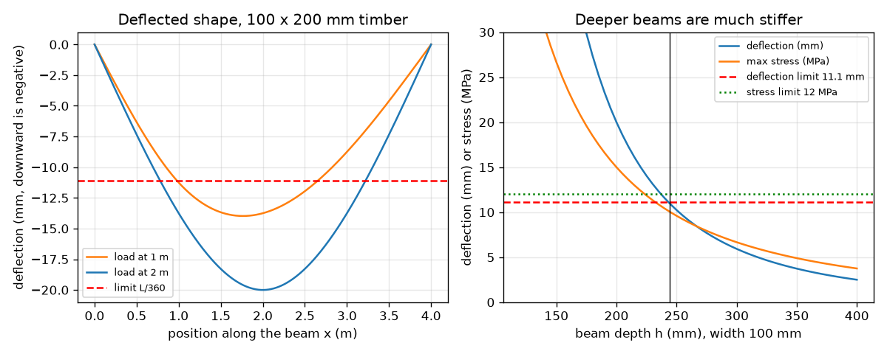
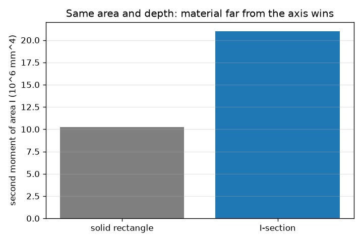

# Session 2: Stiffness and strength: second moment of area, deflection and stress

*Level 2 (mathematical engineering model) · about 80 minutes · openbeam*

> This is a simplified educational model. It is not a validated design tool and must not be used for real structures, electrical installations, vehicles, industrial processes or medical decisions.

**Prerequisites**

- Session 1: reactions and bending moment.
- Powers and cubes; reading a graph of a curve.

**Learning objectives.** After this session you can:

- Compute the second moment of area I for a rectangle and an I-section, and say why depth matters most.
- Compute the deflection of a point-loaded beam and compare it with a limit such as L/360.
- Compute the bending stress sigma = M y / I and compare it with an allowable stress.
- Solve a design problem: the lightest rectangle that passes both the deflection and the stress test.

## A. Real-world problem
Two planks of the same wood and width span a stream. One lies flat, the other stands on edge. The one on edge hardly bends. Why, when both hold the same amount of wood? And if a rule says the beam may sag at most L/360 and the wood may not be stressed beyond a limit, what is the lightest beam that passes? (Classroom model, not a design method: real design codes add load factors, material grades and many more checks.)

## B. Concept and theory
How much a beam bends depends on the loads and on its stiffness EI: the material stiffness E (Young's modulus) times the shape stiffness I (second moment of area). Material far from the neutral axis counts more, because each small area dA contributes y squared times dA, so depth enters as h cubed. For a point load the deflected curve and the maximum deflection follow from Euler-Bernoulli beam theory. The bending stress at distance y from the neutral axis is M y / I; it is largest at the top and bottom faces.

| Symbol | Meaning | Unit |
|---|---|---|
| E | Young's modulus of the material | Pa (GPa in the app) |
| I | second moment of area of the cross-section | m^4 (mm^4) |
| b, h | width and depth of a rectangular section | m (mm) |
| v(x) | downward deflection at position x | m (mm) |
| sigma | bending stress | Pa (MPa) |
| y | distance from the neutral axis | m |
| L/360 | common deflection limit (span divided by 360) | m |

**Assumptions**

- Straight, elastic beam of constant section; deflections small compared with the span.
- Plane sections stay plane (Euler-Bernoulli); shear deformation is ignored.
- The material is the same everywhere and behaves the same in tension and compression.
- The allowable stress of 12 MPa and the limit L/360 are teaching values, not code values.

$$ I_{\mathrm{rect}}=\frac{b\,h^{3}}{12},\qquad I_{\mathrm{I}}=\frac{b_f h^{3}-(b_f-t_w)(h-2t_f)^{3}}{12} $$

$$ v(x)=\frac{P\,b\,x\,(L^{2}-b^{2}-x^{2})}{6\,E\,I\,L}\ (x\le a),\qquad v_{\max}=\frac{P\,L^{3}}{48\,E\,I}\ \text{(load at centre)} $$

$$ \sigma=\frac{M\,y}{I},\qquad \sigma_{\max}=\frac{M_{\max}\,(h/2)}{I},\qquad M_{\max}=\frac{P\,a\,b}{L} $$

## C. Visual explanation
The first figure shows the deflected shape of a 100 mm by 200 mm timber beam for two load positions, with the L/360 limit as a red dashed line: the beam sags 20 mm in the middle against a limit of 11.1 mm. The right graph sweeps the depth from 120 to 400 mm: both the deflection and the maximum stress fall as the beam gets deeper, and the black line marks the lightest depth, 244 mm, where the deflection curve finally drops under its limit. The second figure compares a solid rectangle with an I-section of the same area and depth: the I-section is twice as stiff because its material sits far from the neutral axis.

*Left: deflected shape against the L/360 limit. Right: deflection and stress against beam depth; the vertical line marks the lightest passing depth, 244 mm.*

*A solid rectangle and an I-section with the same area and depth: the I-section has about twice the second moment of area.*

## D. Interactive simulation
Run the lesson (`python start.py 2`), then open the live app: [Session 2: deflection, stress and the lightest beam](https://krunalpanchal1995.github.io/openbeam/session-02/) (or `app.html` in this folder). Raise the depth slider and watch the deflection and stress fall, then try the same increase in width. Open the demand graph and see which curve crosses 1 last: that is the limit that governs.

**Challenge.** Make the beam pass both tests (deflection at most L/360 and stress at most 12 MPa) with a cross-section of no more than 30 000 mm^2.

## E. Worked example and experiment
**Problem.** A timber beam (E = 10 GPa) spans L = 4 m with a 10 kN load at mid-span. The section is 100 mm wide and 200 mm deep. Find I, the maximum deflection, the maximum stress, and compare with L/360 and 12 MPa.

1. I = b h^3 / 12 = 0.100 x 0.200^3 / 12 = 6.667 x 10^-5 m^4 (66.67 x 10^6 mm^4).
2. Deflection = P L^3 / (48 E I) = 10 000 x 64 / (48 x 10 x 10^9 x 6.667 x 10^-5) = 640 000 / 32 000 000 = 0.0200 m = 20.0 mm.
3. Limit L/360 = 4 / 360 = 11.1 mm. The beam sags too much.
4. M max = P L / 4 = 10 x 4 / 4 = 10 kN m. Stress = M (h/2) / I = 10 000 x 0.100 / 6.667 x 10^-5 = 15.0 MPa. This is above 12 MPa too.
5. Fix by depth: deflection scales as 1/h^3, so we need h >= 200 x (20 / 11.11)^(1/3) = 243.2 mm; stress scales as 1/h^2, so h >= 200 x sqrt(15/12) = 223.6 mm. Deflection governs. The lightest depth in whole millimetres is 244 mm (area 24 400 mm^2), with deflection 11.01 mm and stress 10.1 MPa.

**Answer.** I = 6.667e-5 m^4, deflection 20.0 mm (too much), stress 15.0 MPa (too much); the lightest passing 100 mm wide rectangle is 244 mm deep.

**Experiment.** Load a wooden ruler or a plastic strip across two books with a small weight at the middle, once lying flat and once on edge. Measure the sag with a second ruler. Theory says on edge is (depth ratio)^2 times stiffer, e.g. 25 mm wide by 3 mm thick gives 69 times. Real strips will not show exactly 69 because the load point, the supports and the material are imperfect, and a thin flat strip may twist: the model is for a straight elastic beam with a perfect point load.

## F. Assessment and design challenge
**Question type A: Conceptual.** Why does increasing a beam's depth often improve bending stiffness more effectively than adding the same amount of material near the neutral axis?

Hint

Write I = b h^3 / 12 and ask what each small piece of area contributes, and how far from the axis it is.

Step-by-step solution

Each small piece of area contributes y squared times dA to I, so pieces far from the neutral axis count much more than pieces near it. Material put into depth is placed farther from the axis (and I grows as h cubed), while the same material added next to the axis, for example as extra width, only multiplies I by the same factor as the width (I grows only linearly with b). Example: adding 20% area as depth multiplies I by 1.728, as width only by 1.2.

**Question type B: Numerical.** A timber beam 50 mm wide and 150 mm deep, E = 12 GPa, spans 3 m with a 5 kN load at mid-span. Find the maximum deflection and stress, with units, and compare with L/360 and 12 MPa.

Hint

I = b h^3 / 12; deflection = P L^3 / (48 E I); M = P L / 4.

Step-by-step solution

I = 0.050 x 0.150^3 / 12 = 1.406 x 10^-5 m^4. Deflection = 5000 x 27 / (48 x 12 x 10^9 x 1.406 x 10^-5) = 0.0167 m = 16.7 mm, against the limit 3000 / 360 = 8.33 mm: fails. M = 5 x 3 / 4 = 3.75 kN m; stress = 3750 x 0.075 / 1.406 x 10^-5 = 20.0 MPa, above 12 MPa: fails. Sanity check: a person-sized load on a slim plank sagging 17 mm over 3 m is believable.

**Question type C: Graph and simulation interpretation.** On the demand graph (demand divided by limit against depth) the blue curve crosses 1 at about 243 mm and the green curve at about 224 mm. Which limit governs and what does it mean for the designer?

Hint

The beam passes only when both curves are at or below 1.

Step-by-step solution

The beam needs a depth of at least the larger of the two crossing depths, 243 mm, so the deflection limit governs. The beam is then stronger than needed against stress (stress at 244 mm is about 10.1 MPa against 12 MPa). To lighten the beam the designer must increase stiffness per unit material, for example by choosing a shape with material far from the axis, or a stiffer material.

**Question type D: Design and optimisation challenge.** Design: with E = 10 GPa, L = 4 m and the 10 kN centre load, compare two ways of reaching the required stiffness: keep the width at 100 mm and increase the depth, or keep the depth at 200 mm and increase the width. Which uses less material, and by how much?

Hint

Required I is 20 / 11.11 = 1.8 times the current I. Depth route: h^3 scales; width route: b scales.

Step-by-step solution

Required I = 1.8 x 6.667 x 10^7 = 1.2 x 10^8 mm^4. Depth route: h = 243.2 mm, area 100 x 243.2 = 24 320 mm^2. Width route: b = 100 x 1.8 = 180 mm, area 180 x 200 = 36 000 mm^2. The depth route uses about 32% less material. Stress also passes both ways. Trade-offs: a deep thin beam may twist sideways (not modelled here) and may not fit the available room.

Score yourself with [RUBRIC.md](../../RUBRIC.md). Print the [activity sheet](activity_sheet.md) to work on paper.

## Common misconceptions
| Common misconception | What is actually true |
|---|---|
| Doubling the material doubles the stiffness. | It depends where the material goes: doubling the width doubles I, doubling the depth multiplies it by 8. |
| A beam that is strong enough is also stiff enough. | Strength (stress limit) and stiffness (deflection limit) are different tests; in the worked example deflection governs. |
| Stress is the same all over the cross-section. | Bending stress is zero at the neutral axis and largest at the top and bottom faces: sigma = M y / I. |

## Glossary
- **second moment of area**: a shape property I that says how well a cross-section resists bending (m^4)
- **neutral axis**: the line through the cross-section where bending stress is zero
- **Young's modulus**: E, the material's stiffness: stress divided by strain (Pa)
- **deflection**: how far the beam sags from its unloaded line
- **allowable stress**: the largest bending stress a design permits

## Finish
1. Do the three coding tasks in [exercises.md](exercises.md).
2. Run `python start.py 2` again after your changes. It ends with the checkpoint; when it prints `PASS`, you are done. (Checkpoint only: `python start.py check 2`.)

Next: [Session 3](../session-03/README.md)
