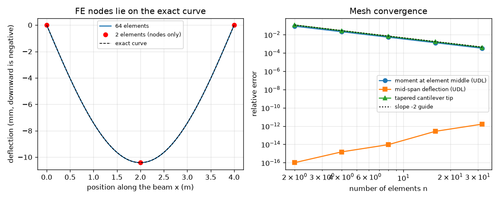
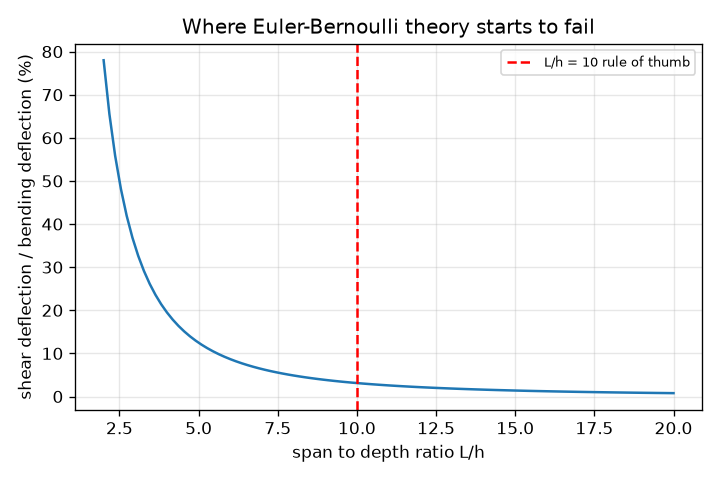

# Session 3: Solve it numerically: a finite-element beam, validated and refined

*Level 3 (simulation and validation) · about 90 minutes · openbeam*

> This is a simplified educational model. It is not a validated design tool and must not be used for real structures, electrical installations, vehicles, industrial processes or medical decisions.

**Prerequisites**

- Session 1: reactions and bending moment.
- Session 2: second moment of area, deflection and stress.
- Matrices and solving K d = F (explained in the lesson).

**Learning objectives.** After this session you can:

- Assemble and solve a 2-node Euler-Bernoulli finite-element beam with uniform and point loads.
- Validate the solver against exact formulas, including a point load that does not sit on a node.
- Measure mesh convergence and say how fast the errors fall for deflection and moment.
- Run a sensitivity study (E, depth) and name a limit of the theory (shear deformation).
- Use the solver for a footbridge-style check with a self-weight, a deflection limit and a factor of safety.

## A. Real-world problem
Real beams have distributed loads, several point loads and sections that change along their length. Formulas exist for only a few simple cases. A finite-element program cuts the beam into short elements and solves them together, but how do we know it is right? We run it on cases with exact answers, study what happens as the mesh is refined, and only then trust it on cases with no formula. And a simple question remains for the engineer: which is the lightest beam that sags less than L/360 and keeps its factor of safety? This is a classroom model; it is never a design tool for real structures.

## B. Concept and theory
The beam is cut into n elements of length le. Each node has a deflection w and a slope theta. Inside an element the deflection is a cubic (Hermite) curve, which is the exact solution of the beam equation between loads, so a 4 x 4 stiffness matrix links the four end values to the four end forces. The element matrices are added into a global matrix K, loads are turned into a force vector F, the supports remove some unknowns, and solving K d = F gives all w and theta. The bending moment follows from the curvature, M = -EI w''; here it is averaged over each element, so it converges more slowly than the deflection. Euler-Bernoulli theory ignores shear deformation, which adds about E h^2 / (kappa G L^2) of extra deflection to a centre-loaded rectangular beam.

| Symbol | Meaning | Unit |
|---|---|---|
| n | number of elements | none |
| le | element length L / n | m |
| w, theta | nodal deflection (downward) and slope | m, rad |
| K, F, d | global stiffness matrix, load vector, unknowns | N/m, N and N m, m and rad |
| q | uniform load per metre | N/m |
| EI | bending stiffness | N m^2 |
| fos | factor of safety on yield: yield stress / actual stress | none |
| kappa | shear coefficient of the section (5/6 for a rectangle) | none |

**Assumptions**

- Straight, elastic beam, small deflections, plane sections stay plane.
- EI is constant inside an element (taken at its middle for tapered beams).
- Loads act in the plane of bending; no buckling, vibration, connections or fatigue.
- Steel has E = 200 GPa, density 7850 kg/m^3, yield 250 MPa (teaching values).

$$ k_e=\frac{EI}{l_e^{3}}\begin{pmatrix}12&6l_e&-12&6l_e\\6l_e&4l_e^{2}&-6l_e&2l_e^{2}\\-12&-6l_e&12&-6l_e\\6l_e&2l_e^{2}&-6l_e&4l_e^{2}\end{pmatrix},\qquad K\,d=F $$

$$ w_{\mathrm{centre}}=\frac{P\,L^{3}}{48\,EI},\qquad w_{\mathrm{UDL}}=\frac{5\,q\,L^{4}}{384\,EI},\qquad w_{\mathrm{tip}}=\frac{P\,L^{3}}{3\,EI} $$

$$ \frac{w_{\mathrm{shear}}}{w_{\mathrm{bend}}}\approx\frac{E\,h^{2}}{\kappa\,G\,L^{2}}=\frac{2(1+\nu)}{\kappa\,(L/h)^{2}} $$

## C. Visual explanation
The left figure shows a uniform-load beam solved with only 2 elements: the dots at the nodes already sit on the exact curve, and a 64-element solution is indistinguishable from it. The right figure is a log-log plot of the error against the number of elements. The deflection error is at round-off level (about 1e-12), while the moment error and the tapered-beam error fall on a line of slope -2: halving the element length cuts the error by 4. A third figure shows how much extra deflection shear adds as the beam gets deeper compared with its span: 3.1% at L/h = 10, 12.5% at L/h = 5.

*Left: 2-element nodes (dots) lie on the exact curve. Right: log-log error against the number of elements for moment, deflection and a tapered beam.*

*Extra deflection from shear against span-to-depth ratio L/h, with the L/h = 10 rule of thumb.*

## D. Interactive simulation
Run the lesson (`python start.py 3`), then open the live app: [Session 3: a finite-element beam against the exact answer](https://krunalpanchal1995.github.io/openbeam/session-03/) (or `app.html` in this folder). Start with 4 elements and an off-node point load and compare the blue and grey curves in the shape view and the step line in the moment view. Raise the number of elements and watch the readout errors fall. Then change the depth and see how the deflection responds.

**Challenge.** With the point load at zero, meet the L/360 deflection limit and use at least 10 elements, so that the finite-element peak moment is within about 1.5% of the exact one.

## E. Worked example and experiment
**Problem.** A simply supported steel beam spans L = 4 m with E I = 200 GPa x 8.0e-6 m^4 = 1.6e6 N m^2. Find the mid-span deflection (a) for a 10 kN centre load, (b) for a uniform load of 5 kN/m, and compare each with the finite-element solver on a 2-element and an 8-element mesh. Then give both loads together.

1. (a) w = P L^3 / (48 E I) = 10 000 x 64 / (48 x 1.6e6) = 640 000 / 76 800 000 = 0.008333 m = 8.333 mm.
2. (b) w = 5 q L^4 / (384 E I) = 5 x 5000 x 256 / (384 x 1.6e6) = 6 400 000 / 614 400 000 = 0.010417 m = 10.417 mm.
3. Run solve_beam: the 2-element mesh gives 8.3333 mm for (a), the 8-element mesh gives 10.4167 mm for (b). They agree with the formulas to 7 digits or better, because for constant EI the cubic element is exact at the nodes.
4. Both loads act together: deflections add (superposition for a linear elastic beam), 8.333 + 10.417 = 18.75 mm.
5. Why still refine the mesh? The moment is a second derivative of w; the element-average moments approach the true moment only as the elements shrink (error about 4 / (3 n^2) of the peak for a uniform load).

**Answer.** 8.333 mm for the centre load, 10.417 mm for the uniform load, 18.75 mm for both; the solver matches to better than 1e-7.

**Experiment.** Clamp a steel ruler (25 mm wide, 1 mm thick) as a cantilever, hang a small mass from the tip and measure the tip sag; repeat with the ruler turned on edge. The solver predicts P L^3 / (3 E I), so the ratio of the two sags is the ratio of the I values, (25/1)^2 = 625 (in practice the edge-on ruler barely moves and twists). Real rulers differ because the clamp is not perfectly rigid, the ruler's own weight bends it, and the steel grade sets E to within about 5%: the model has a perfectly rigid support and a known E.

## Real-world application and mini-project: Check a footbridge girder (classroom exercise only)
A small footbridge span of 6 m rests on two identical steel girders. One girder carries a uniform service load of 3.5 kN/m (deck and pedestrians) plus a 5 kN point load at mid-span, and its own weight. Steel: E = 200 GPa, yield stress 250 MPa. Required: deflection at most L/360 and a factor of safety of 1.5 on the yield stress. Try I-sections with flanges 150 mm x 10 mm and a web 6 mm thick, with depths from 100 mm to 400 mm in steps of 10 mm, using `check_footbridge` from Session 3. This is a teaching exercise: real footbridges also need vibration, buckling, connection and load-combination checks by a qualified engineer, and nothing here may be used to design or assess a real structure.

**Deliverable:** A script that prints, for each depth, the deflection (mm), the maximum bending stress (MPa), the mass per metre (kg/m) and PASS or FAIL, then names the lightest passing depth and which limit governed it, and saves a plot of deflection and stress against depth.

**Success looks like:** The lightest passing depth is 190 mm (deflection 16.2 mm against a limit of 16.7 mm, mass 31.6 kg/m), the 180 mm section fails the deflection limit, and you explain why raising the factor of safety to 3 changes the answer only a little.

## F. Assessment and design challenge
**Question type A: Conceptual.** The finite-element deflection is exact at the nodes even with 2 elements, but the bending moment is not. Why?

Hint

Between loads the exact deflection of a beam is a cubic curve. What does the moment need from the curve?

Step-by-step solution

The element's cubic shape functions can reproduce the exact deflection between loads, and the consistent load vector puts the nodal values on the exact curve (for constant EI). The moment needs the second derivative of w; the element-average second derivative approximates the true moment only to second order in the element length, so the moment converges as 1/n^2 instead of being exact.

**Question type B: Numerical.** A simply supported beam of span 5 m, EI = 2.0e6 N m^2 carries a uniform load of 4 kN/m. Find the mid-span deflection and its maximum moment with units, and say what the 4-element solver's moment error against the peak should be.

Hint

Use 5 q L^4 / (384 EI) and q L^2 / 8. The element-moment error against the peak is 4 / (3 n^2).

Step-by-step solution

w = 5 x 4000 x 625 / (384 x 2.0e6) = 12 500 000 / 768 000 000 = 0.01628 m = 16.3 mm. M max = 4000 x 25 / 8 = 12 500 N m = 12.5 kN m. For n = 4 the element-average error against the peak is 4 / (3 x 16) = 8.3%, so the solver would show about 11.5 kN m. Sanity check: a 5 m steel beam sagging 16 mm (L/307) is plausible for a light section.

**Question type C: Graph and simulation interpretation.** On the log-log convergence plot, the moment error is 2.1% of the peak for n = 8. Estimate it for n = 32 and say what slope the line has.

Hint

The line has slope -2: error proportional to 1/n^2.

Step-by-step solution

n = 32 is 4 times as many elements, so the error is 4^2 = 16 times smaller: 2.1% / 16 = 0.13% (the lesson prints 0.13%). The slope is -2 on a log-log plot. Deflection errors, at round-off level, do not follow this line.

**Question type D: Design and optimisation challenge.** Design: for the footbridge girder (6 m span, 3.5 kN/m, 5 kN at mid-span, steel, flanges 150 x 10 mm, web 6 mm, depths in 10 mm steps) find the lightest passing depth with a factor of safety of 1.5, and then with a factor of safety of 3. Which limit governs and what does it cost in mass?

Hint

Run check_footbridge for each depth; the stress test is fos x stress <= 250 MPa; the deflection test is w <= L/360.

Step-by-step solution

With fos 1.5 the lightest passing depth is 190 mm: deflection 16.2 mm (limit 16.67 mm), stress 87.3 MPa, mass 31.6 kg/m. With fos 3, stress must be at most 83.3 MPa, which needs 200 mm (stress 82.1 MPa, mass 32.0 kg/m). The deflection limit governs with fos 1.5, and a doubled factor of safety costs only about 1.5% in mass. Assumptions: static load only; real footbridges need vibration and buckling checks.

Score yourself with [RUBRIC.md](../../RUBRIC.md). Print the [activity sheet](activity_sheet.md) to work on paper.

## Common misconceptions
| Common misconception | What is actually true |
|---|---|
| A finer mesh always changes the deflection answer. | For constant EI the nodal deflections are already exact; refinement matters for moments, tapered sections and for finding the peak between nodes. |
| If the program prints a number it must be right. | A solver is only trusted after it reproduces exact cases and its errors fall as the mesh is refined. |
| A factor of safety makes a design safe. | It covers only the one calculation done; here deflection governed, buckling and vibration were not checked at all. |

## Glossary
- **finite element**: a short piece of beam with its own stiffness relation
- **mesh**: the set of elements and nodes the beam is divided into
- **node**: a point where elements join; carries a deflection and a slope
- **convergence**: the error shrinking as the mesh is refined
- **factor of safety**: yield stress divided by the actual stress
- **superposition**: adding the results of separate loads for a linear elastic beam

## Finish
1. Do the three coding tasks in [exercises.md](exercises.md).
2. Run `python start.py 3` again after your changes. It ends with the checkpoint; when it prints `PASS`, you are done. (Checkpoint only: `python start.py check 3`.)

Next: the [roadmap](../../promo/roadmap.md). Session 4 is yours to build.
